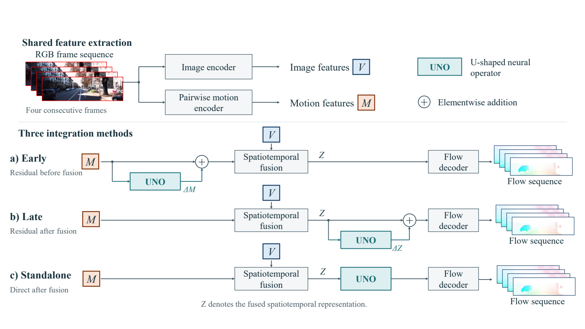
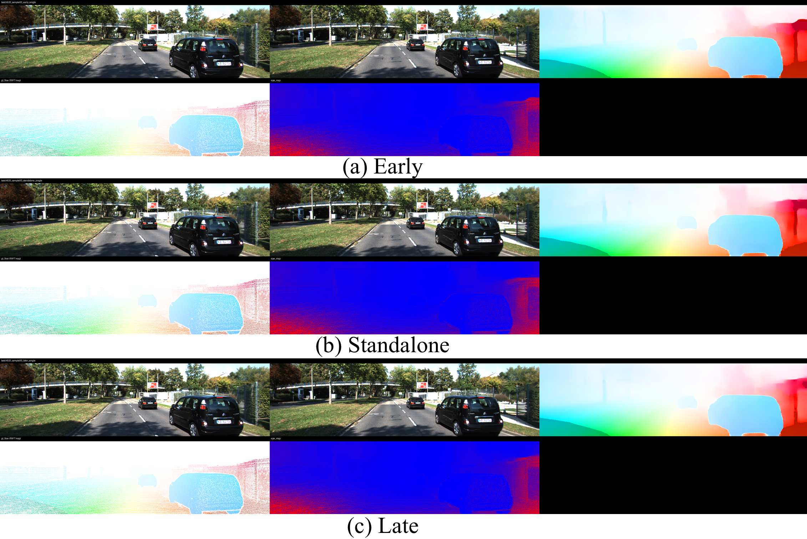
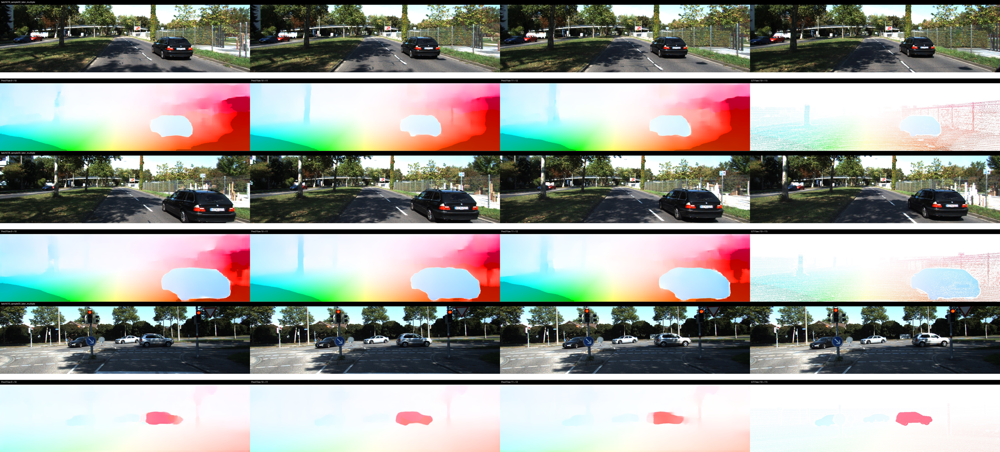

<h1 align="center">Short-Horizon Temporal Optical Flow with<br>Physics-Inspired Consistency</h1>

<p align="center">
  <a href="mailto:sihan.yao@dukekunshan.edu.cn">Sihan Yao</a><sup>*</sup>,
  <a href="mailto:y.huang@dukekunshan.edu.cn">Yuxuan Huang</a><sup>*</sup>, and
  <a href="mailto:peng.sun568@dukekunshan.edu.cn">Peng Sun</a><sup>†</sup>
</p>

<p align="center">
  Duke Kunshan University<br>
  <sup>*</sup> Equal contribution &nbsp; <sup>†</sup> Corresponding author<br>
  🎉 <strong>Accepted at the 6th INSAI conference (INSAI 2026)</strong>
</p>

## 📣 News

- **2026-11-18** — Code released.
- **2026-11-03** — Paper accepted at the 6th INSAI conference (INSAI 2026).

This repository contains the PyTorch implementation of the paper’s optical flow model. Given four consecutive RGB frames, it estimates three dense displacement fields, one for each adjacent frame pair. The paper studies where a U-shaped Fourier neural operator (UNO) should act on motion features and how to train the sequence when KITTI supplies flow labels for only one pair.

## 🧠 Architecture



A shared pairwise encoder builds local correlation volumes. A second encoder extracts visual features, which are fused with motion features across the clip. A coarse-to-fine decoder converts the resulting representation into flow. The **Early** and **Late** variants add the operator output as a residual at their respective integration points. **Standalone** passes the operator output directly to the decoder. The **CNN** baseline uses convolutional processing.

FlyingChairs pretraining uses two frames and one dense flow target. KITTI fine-tuning transfers the pairwise encoder, visual and motion branches, fusion module, and decoder. The UNO and its projection head are initialized for the four-frame input. Training combines edge-weighted supervised endpoint error with photometric reconstruction, edge-aware smoothness, forward–backward consistency, and two-step reconstruction.

## 📊 KITTI 2015 results

Table 1 of the paper reports these values on **200 KITTI 2015 training sequences** after FlyingChairs pretraining and KITTI fine-tuning. EPE is endpoint error in pixels. Fl-all is the percentage of valid pixels classified as outliers. Lower values are better in every column.

| Variant (CLI name) | EPE | Fl-all (%) | Foreground EPE | Background EPE | Two-step L1 |
| --- | ---: | ---: | ---: | ---: | ---: |
| CNN (`cnn`) | 2.0112 | **10.08** | **2.1030** | 1.9940 | **0.06346** |
| Standalone (`standalone`) | 2.2003 | 14.51 | 2.6458 | 2.1166 | 0.06968 |
| Early (`early`) | **1.7874** | 10.72 | 2.2126 | **1.7076** | 0.06419 |
| Late (`later`) | 2.5052 | 18.49 | 4.5734 | 2.1169 | 0.06380 |

## 🖼️ Qualitative examples

**Pairwise flow.** Early, Standalone, and Late integration estimate motion for the same KITTI image pair. Compare the predicted flow around the car on the right with the sparse ground truth and endpoint-error map beneath each prediction.



**Four-frame sequences.** Each scene shows four consecutive frames above three predicted flow fields from Late integration, one for each transition. The lower-right panel shows the available KITTI ground truth.



## 🚀 Train and evaluate

Run the commands below from `Model/` in a Python environment with a compatible PyTorch and torchvision installation.

```bash
cd Model
python -m pip install -r requirements.txt
```

Download FlyingChairs and the KITTI 2015 scene-flow training data and multiview RGB frames. The Chairs loader accepts the release directory or its `data/` subdirectory. Under your KITTI root, the loader expects the following layout. The evaluator uses the object maps for foreground and background metrics.

```text
Additional_frames/training/image_2/
Flow/training/flow_occ/
Flow/training/disp_occ_0/
Flow/training/disp_occ_1/
Flow/training/obj_map/
```

Replace the dataset paths below with your local paths. This example trains Early integration, then evaluates its best KITTI checkpoint. To use the official FlyingChairs split, add `--chairs_split_file "/path/to/chairs_split.txt"` to the first command.

```bash
python -m training.pre_trainer --config config.json --chairs_root "/path/to/FlyingChairs_release" --architecture_type early
python -m training.finetune_kitti_from_chairs --config config.json --data_root "/path/to/KITTI" --architecture_type early --pretrained_chairs checkpoints/chairs_pretrain_early_best.pth
python -m evaluation.eval_extended_metrics --data-root "/path/to/KITTI" --architectures early --device cuda
```

The training commands write weights to `checkpoints/`. Evaluation writes per-scene statistics and summaries to `evaluation_outputs/extended_metrics/`. To inspect a prediction, run:

```bash
python -m visualization.visualization --config config.json --data_root "/path/to/KITTI" --checkpoint checkpoints/fullpipeline_early_kitti_from_chairs_best.pth --architecture_type early --mode multiple --max_samples 1
```

The repository includes the model configuration and RGB normalization statistics. Dataset downloads and trained weights are separate from the source release.

## 🙏 Acknowledgements

We thank the NeuralOperator developers for their open-source implementation, which provides the UNO components used in this work. The bundled source retains the upstream MIT license. [NeuralOperator](https://github.com/neuraloperator/neuraloperator) · [License](Model/neuralop_seg/LICENSE)

We also thank the creators of FlyingChairs and the KITTI Vision Benchmark Suite for the datasets used for pretraining, fine-tuning, and evaluation. [FlyingChairs](https://lmb.informatik.uni-freiburg.de/resources/datasets/FlyingChairs.en.html) · [KITTI](https://www.cvlibs.net/datasets/kitti/)
